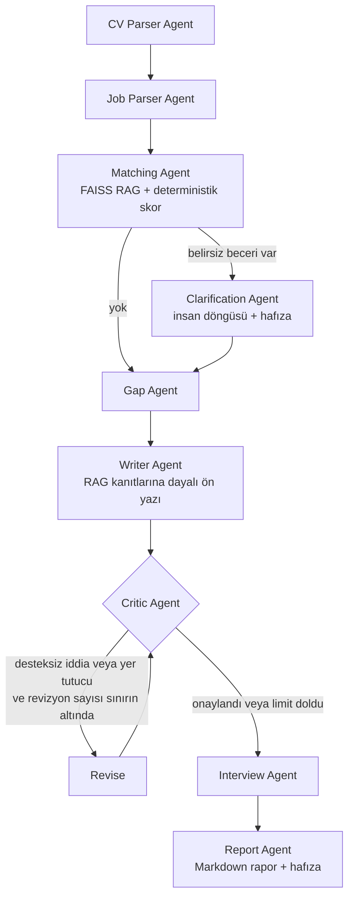

# CV-İlan Eşleştirme ve Başvuru Koçu

Agentic AI Bootcamp kapanış projesi. Bir **CV** ve bir **iş ilanı** verildiğinde LangGraph tabanlı
çoklu agent sistemi; ikisini ayrıştırır, becerileri eşleştirir, belirsiz noktaları **kullanıcıya sorar**,
eksikler için plan çıkarır, CV'ye dayalı bir **ön yazı** yazar, yazıyı **denetleyip revize eder** ve
mülakat hazırlığıyla birlikte tek bir Markdown raporu üretir. Her şey yerelde (Ollama) çalışır,
API anahtarı gerekmez.

## Çözülen problem

İş arayan biri her ilan için aynı işi tekrar eder: CV'sini ilanla elle karşılaştırır, eksiklerini
tahmin eder, ilana özel ön yazı yazar ve mülakata hazırlanır. Bu süreç yavaştır ve tutarsızdır.
Ön yazı yazarken CV'de olmayan iddialar da kolayca araya girer.

### Neden tek bir LLM çağrısı yetmez?

| İhtiyaç | Basit LLM çağrısı | Bu projedeki çözüm |
|---|---|---|
| Tekrarlanabilir uyum skoru | Her seferinde farklı sayı üretir | Skor **deterministik Python kodu** ile hesaplanır |
| "Kafka var mı?" gibi belirsiz durumlar | Uydurur veya varsayar | Agent **durur ve kullanıcıya sorar**, cevabı **kalıcı hafızaya** yazar |
| Ön yazıda uydurma bilgi | Denetimsiz bırakır | **Critic agent** CV ile karşılaştırır, reddederse revizyon döngüsü çalışır |
| Küçük modelin bozuk/boş çıktısı | Sessizce yanlış sonuç verir | Şema doğrulama, yeniden deneme, ikinci prompt; yine olmazsa net hata |
| İlandaki beceri için kanıt bulma | Tüm CV'yi her seferinde okutur | **RAG**: FAISS ile yalnızca ilgili CV satırları getirilir |

## Mimari



| Eğitimde işlenen yaklaşım | Projedeki karşılığı |
|---|---|
| **Orkestrasyon / çoklu agent** | LangGraph `StateGraph`, koşullu kenarlar, revizyon döngüsü (`graph.py`) |
| **Tool'lar** | Doküman okuma, parçalama, vektör arama, deterministik skorlama (`tools/`) |
| **RAG** | CV satır bazında FAISS'e gömülür; beceri kanıtı ve ön yazı bağlamı buradan gelir (`01_create_vector_db.py`, `tools/cv_tools.py`) |
| **Hafıza** | Kullanıcının doğruladığı beceriler ve geçmiş başvurular `memory/memory.json`'da saklanır; aynı beceri bir daha sorulmaz (`tools/memory_tools.py`) |
| **İnsan döngüsü** | Belirsiz becerilerde Clarification Agent kullanıcıdan bilgi ister, skor yeniden hesaplanır |
| **Öz-denetim (reflection)** | Critic Agent + kodla yapılan yer tutucu kontrolü |
| **Hata yönetimi** | Bozuk/boş dosya, Ollama'ya ulaşılamaması, geçersiz model çıktısı, boş beceri listesi |

## Kullanılan teknolojiler

- **Python 3.12+** (3.14 ile test edildi)
- **LangGraph**: agent akışı ve state yönetimi
- **LangChain (Ollama, Community)**: yerel LLM / embedding erişimi ve FAISS entegrasyonu
- **Ollama**: `gemma3:4b` (sohbet ve yapılandırılmış çıktı), `qwen3-embedding:0.6b` (embedding)
- **FAISS**: CV için vector database
- **Pydantic**: LLM çıktılarının şema doğrulaması (JSON schema ile kısıtlı üretim)
- **pypdf**: PDF okuma, **Rich**: terminal arayüzü, **python-dotenv**: yapılandırma, **pytest**: testler

**Teknoloji gerekçeleri:** Yerel model seçildi çünkü CV kişisel veri içerir ve dışarı gönderilmemelidir;
ayrıca API anahtarı veya ücret gerektirmez. `gemma3:4b`, bu projede denenen `qwen3:4b` sürümünün
aksine "düşünme" çıktısı üretmediği için CPU'da çok daha hızlı yanıt verir.

## Proje yapısı

```
01_create_vector_db.py     CV'yi parçalar, embedding oluşturur, FAISS vector database kaydeder
02_cv_job_coach.py         Uygulamanın çalıştırıldığı CLI
config.py                  LLM, embedding ve genel ayarlar
graph.py                   LangGraph akışı
state.py                   Graph state yapısı
schemas.py                 LLM çıktı şemaları (Pydantic)
prompts.py                 Agent prompt'ları
agents/                    cv_parser, job_parser, matching, clarification, gap,
                           writer, critic, interview, report
tools/                     document, cv (FAISS), scoring, memory, report, llm yardımcıları
data/                      Kurgusal örnek CV (txt/pdf) ve ilan
tests/                     pytest testleri
```

## Kurulum

Ön koşullar: Python 3.12+ ve çalışan bir [Ollama](https://ollama.com) kurulumu.

```bash
# 1) Modelleri indirin
ollama pull gemma3:4b
ollama pull qwen3-embedding:0.6b

# 2) Sanal ortam ve bağımlılıklar
python -m venv venv
# Windows:  venv\Scripts\activate      Linux/macOS:  source venv/bin/activate
pip install -r requirements.txt

# 3) (İsteğe bağlı) ayarlar
cp .env.example .env
```

`.env` içindeki tüm değerler isteğe bağlıdır; varsayılanlar `.env.example` dosyasında görülebilir.
Gizli anahtar gerekmez, `.env` yine de `.gitignore` içindedir.

## Çalıştırma

```bash
# 1) CV'yi indeksle (vector database oluşturur)
python 01_create_vector_db.py --cv data/sample_cv.pdf

# 2) Uygulamayı çalıştır (kurgusal CV + kurgusal Softtech tarzı ilan)
python 02_cv_job_coach.py --cv data/sample_cv.pdf --job data/sample_job_softtech.txt

# Soru sormadan (etkileşimsiz)
python 02_cv_job_coach.py --cv data/sample_cv.pdf --job data/sample_job_softtech.txt --no-interactive

# İlan URL'si de verilebilir
python 02_cv_job_coach.py --cv cv.pdf --job https://ornek.com/ilan
```

Başka bir CV ile çalışmak için önce `01_create_vector_db.py` o CV ile yeniden çalıştırılmalıdır;
`02` script'i CV ile vector database uyuşmazsa bunu söyler. Rapor `output/` klasörüne Markdown olarak
kaydedilir.

**Not:** Modeller CPU'da çalışıyorsa tam akış birkaç dakika sürebilir (yaklaşık 8-10 LLM çağrısı).

### Testler

```bash
python -m pytest
```

Testler Ollama gerektirmez; sahte LLM ve sahte embedding ile akışı, insan döngüsünü, critic
döngüsünü, hafızayı ve hata durumlarını doğrular.

## Ekran görüntüleri

SCREENSHOTS_PLACEHOLDER

## Bilinen sınırlar

- 4B parametreli yerel model bazen beceri çıkarmayı atlar; bu yüzden boş liste kontrolü, ikinci
  prompt ve deterministik skorlama eklendi. Daha büyük bir model (`CHAT_MODEL`) sonuçları iyileştirir.
- Anlamsal arama kısa anahtar kelimelerde zayıftır; bu yüzden `tools/scoring_tools.py` içinde küçük
  bir "eşdeğer/ilişkili beceri" sözlüğü (`JUnit` → `Unit Testing`, `RabbitMQ` ~ `Kafka`) kullanılır.
- Örnek ilan kurgusaldır; gerçek bir Softtech ilanı değildir.
